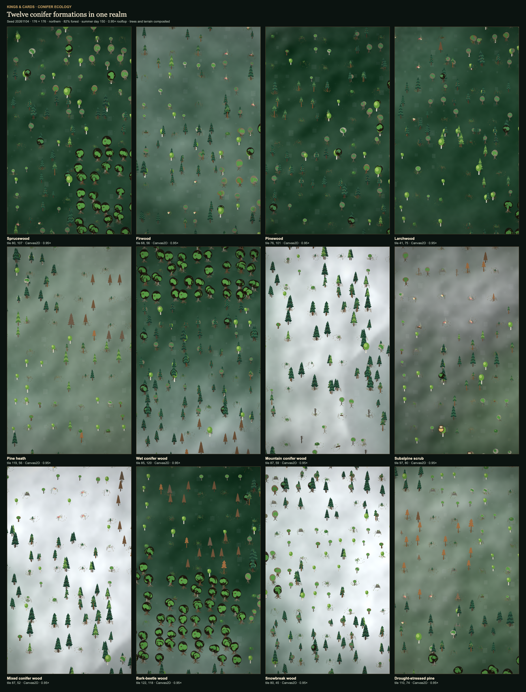
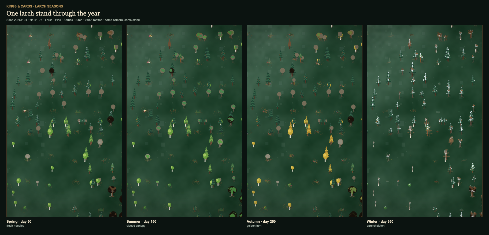

# Nadelwälder (1.2.2)

The conifer biome extends the shared forest ecology rather than adding a second
world model. A stand is generated by `forestStandAt()` from the same seed,
moisture, temperature, height, stock ratio and optional live succession record
used by broadleaf woodland. The result drives terrain colour, tree placement,
forest-floor detail, the forester survey and the gathering ledger.

## Species and forms

| Species | Form | Timber | Character |
| --- | --- | --- | --- |
| Spruce (`spruce`) | narrow drooping spire, 7 tiers | `spruce-timber` | dense dark stands, heavy snow load |
| Fir (`fir`) | broad dense tier stack, 6 tiers | `fir-timber` | deep shade, mossy trunks |
| Pine (`pine`) | long bare trunk with a lifted crown | `pine-timber` | light, dry woods and heath |
| Larch (`larch`) | airy tiers, deciduous needles | `larch-timber` | golden autumn, bare winter branches |
| Juniper (`juniper`) | low many-stemmed scrub | `juniper-timber` | tree line, dry heath, berry crop |

The renderer derives trunk taper, tier width, crown base, lean, branch droop,
cone marks, snow load and wind movement from the species definition, the stand
age class and a deterministic per-tree seed. Ancient trees are broader and
more irregular; young stands stay compact. The `snowbreak` and `bark-beetle`
states add broken leaders and dead/reddened crowns.

## Formations

The twelve conifer formations are appended after the fifteen broadleaf
formations, preserving all existing numeric type indices:

- `sprucewood`, `firwood`, `pinewood`, `larchwood`
- `pine-heath`, `wet-conifer`, `mountain-conifer`, `subalpine-scrub`
- `mixed-conifer`
- `bark-beetle`, `snowbreak`, `drought-stressed`

Distribution is driven by cold, wet, dry and high sites plus coarse conifer,
pine and larch patches. A warm high slope can still remain `hillside`, and a
cold low site can still be birchwood, so the landscape stays a mosaic instead
of switching biome at a hard line.

## Forest floor and microclimate

Conifer stands expose `ground.needles`, `ground.lichen`, `ground.berry`,
`ground.sourSoil`, `visibility` and `lightShaft`. The renderer paints a
rust-brown needle carpet, lichen, blueberry/lingonberry shrubs, moss, ferns,
rock, roots, stumps and fallen logs. Dense stands reduce light and visibility;
the existing canopy-shaft and mist passes continue to use the stand's light and
canopy values. Broadleaf leaf litter is not reused on a conifer floor.

## Products, fauna and disturbance

Conifer goods include per-species timber, spruce/fir/pine cones, resin,
juniper berries, blueberries, lingonberries and lichen. The existing seasonal
gathering ledger decides availability, so berries disappear in winter while
timber and firewood remain workable. Conifer habitats add crossbill,
capercaillie, wolf, lynx and bark-beetle observations to the existing deer,
roe-deer, boar, fox, owl, woodpecker and insect fauna.

Bark-beetle, snowbreak and drought-stressed have their own succession profiles
in `FOREST_SUCCESSION_PROFILES`. Live conifer outbreaks choose their hazard by
season, spread through the existing bounded neighbour scan, lower real forest
stock and recover through the same save-compatible succession model.

## 1.2.2 coverage

| Requirement | Status | Where |
| --- | --- | --- |
| 1.2.2.1 Different conifer species and forms | Implemented | five species, species-specific tier forms |
| 1.2.2.2 Spruce forests | Implemented | `sprucewood` |
| 1.2.2.3 Fir forests | Implemented | `firwood` |
| 1.2.2.4 Pine forests | Implemented | `pinewood` |
| 1.2.2.5 Larch forests | Implemented | `larchwood` |
| 1.2.2.6 Juniper and smaller conifers | Implemented | `juniper`, `subalpine-scrub` |
| 1.2.2.7 Different trunk heights and diameters | Implemented | species height/trunk ratios and age scale |
| 1.2.2.8 Young stands and ancient giants | Implemented | age classes, `ageScale`, ancient age bias |
| 1.2.2.9 Wind-shaped, leaning and damaged trees | Implemented | per-tree lean, windthrow/snowbreak geometry |
| 1.2.2.10 Different crown densities and spacings | Implemented | formation density/openness and crown scale |
| 1.2.2.11 Dense spruce forests | Implemented | `sprucewood` density |
| 1.2.2.12 Dark fir forests | Implemented | `firwood` palette and density |
| 1.2.2.13 Light pine forests | Implemented | `pinewood` palette and openness |
| 1.2.2.14 Larch with seasonal needle loss | Implemented | `larch` deciduous-needle foliage profile |
| 1.2.2.15 Dry pine heath | Implemented | `pine-heath` |
| 1.2.2.16 Wet conifer forests | Implemented | `wet-conifer` |
| 1.2.2.17 Mountain conifer forests | Implemented | `mountain-conifer` |
| 1.2.2.18 Subalpine tree line | Implemented | `subalpine-scrub` |
| 1.2.2.19 Needle layers on the floor | Implemented | `ground.needles`, needle carpet |
| 1.2.2.20 Moss, lichen and low shrubs | Implemented | understorey values and floor renderer |
| 1.2.2.21 Blueberry and lingonberry patches | Implemented | `ground.berry`, berry shrub marks |
| 1.2.2.22 Small fern patches | Implemented | conifer floor fern branch |
| 1.2.2.23 Roots and weathered trunks | Implemented | roots, stumps, logs in floor renderer |
| 1.2.2.24 Acidic nutrient-poor soils | Implemented | `podzol`, `sourSoil` |
| 1.2.2.25 Exposed stones and rocky sections | Implemented | `ground.stones`, rock floor branch |
| 1.2.2.26 Dark forest interiors | Implemented | canopy/light values |
| 1.2.2.27 Light shafts between trunks | Implemented | existing `drawCanopyLight` driven by `lightShaft` |
| 1.2.2.28 Mist between tall conifers | Implemented | existing mist pass uses canopy/light |
| 1.2.2.29 Visibility varying with density | Derived | `stand.visibility`; not a separate fog simulation |
| 1.2.2.30 Wind in crowns | Implemented | per-tree sway and lean |
| 1.2.2.31 Snow loads on branches | Implemented | tier snow polygons and clumps |
| 1.2.2.32 Resin gloss and wet bark | Implemented | bark light edge and resin goods |
| 1.2.2.33 Predominantly evergreen structure | Implemented | four evergreen conifers |
| 1.2.2.34 Snow-covered winter crowns | Implemented | `foliageState` snow, tier caps |
| 1.2.2.35 Spring shoot growth | Implemented | existing `greenUp` and `fresh` foliage |
| 1.2.2.36 Seasonal larch change | Implemented | larch turn/drop/leaf-out |
| 1.2.2.37 Snow depth by elevation/exposure | Implemented | `stand.snowPotential`, `forestSnowDepthAt()`, `snowDepthCm` in the survey; exposed high ground holds a deeper pack |
| 1.2.2.38 Deer, roe deer, boar and fox | Implemented | conifer formation fauna |
| 1.2.2.39 Wolves, lynx and larger predators | Implemented as habitat observations | `wolf`, `lynx` |
| 1.2.2.40 Squirrels and forest mice | Implemented | existing `squirrel`, `mouse` |
| 1.2.2.41 Woodpeckers, owls, crossbills and forest birds | Implemented | `woodpecker`, `owl`, `crossbill`, `capercaillie`, `songbird` |
| 1.2.2.42 Insects, bark beetles and ants | Implemented | `bark-beetle`, `beetle`, `ant` |
| 1.2.2.43 Conifer timber for building and craft | Implemented | per-species timber goods |
| 1.2.2.44 Resin and other tree products | Implemented | `resin`, cones, juniper berries |
| 1.2.2.45 Firewood and charcoal | Implemented | existing wood goods plus conifer firewood |
| 1.2.2.46 Mushrooms and forest berries | Implemented | mushrooms, blueberries, lingonberries |
| 1.2.2.47 Medicinal plants and herbs | Implemented | conifer formation herbs and lichen |
| 1.2.2.48 Hunting products and furs | Implemented | existing game/fur/hides ledger |
| 1.2.2.49 Bark-beetle infestation | Implemented | `bark-beetle`, live succession |
| 1.2.2.50 Drought and drought stress | Implemented | `drought-stressed`, live succession |
| 1.2.2.51 Forest fire risk | Implemented | existing burned profile; conifer bait/stock pressure |
| 1.2.2.52 Windthrow and storm damage | Implemented | existing windthrow plus conifer lean/damage |
| 1.2.2.53 Monocultures and pest vulnerability | Implemented | dense spruce/fir formations and beetle outbreaks |
| 1.2.2.54 Snowbreak | Implemented | `snowbreak`, live succession |

## Survey and local snow

The forester/lumber survey now reports the site's **snow depth in centimetres**
and its **exposure percentage**. `forestSnowDepthAt()` combines the stand's
`exposure` and `snowPotential` with the seasonal snow cover; it returns zero in
summer and a deeper value on high, open ground in winter. Dense conifer canopies
hold more of that snow on their branches, so the renderer scales the weather
snow load with the same local potential. The underlying values are derived from
height, canopy, moisture, temperature and stocking; they add no per-tick state
and no save fields.

The same derived diagnostic layer exposes `fireRisk`, `pestRisk` and
`monoculture` for the forest survey and future events. These are not a second
simulation: they are deterministic properties of the existing stand.

## Visual reference

The dedicated conifer sheet is generated with:

```sh
cd game
npm run test:conifer-reference
```

It starts the fixed northern realm, captures every conifer formation at the same
0.95× rooftop camera, and follows a larchwood through days 50, 150, 250 and 350.
The outputs are `docs/terrain-reference/conifer-reference.png`,
`conifer-seasons.png` and `conifer-reference.json`; the JSON records the exact
tile, species, exposure, snow potential and winter snow depth behind every
frame.

The checked-in formation sheet is a 3×4 grid at summer day 150. The larch strip
uses the same tile (41, 75) and camera for days 50, 150, 250 and 350, so the
fresh-needle, closed-canopy, golden-turn and bare-skeleton stages are directly
comparable. High-altitude crowns are evaluated before the snow/rock early exits
in `terrain.js`; without that order, `mountain-conifer`, `mixed-conifer` and
`snowbreak` render as empty snowfields.





## Verification

- `tests/world/conifer-forest.test.js` covers species, formations, reachability,
  needle floor, podzol, fauna, seasonal products, larch timing and succession.
- `tests/world/forest-ecology.test.js` keeps the shared vegetation contract and
  the 27 formation indices stable.
- `tests/rendering/seasonal-foliage.test.js` protects the evergreen/snow curves.
- Full suite: `cd game && npm test`.
