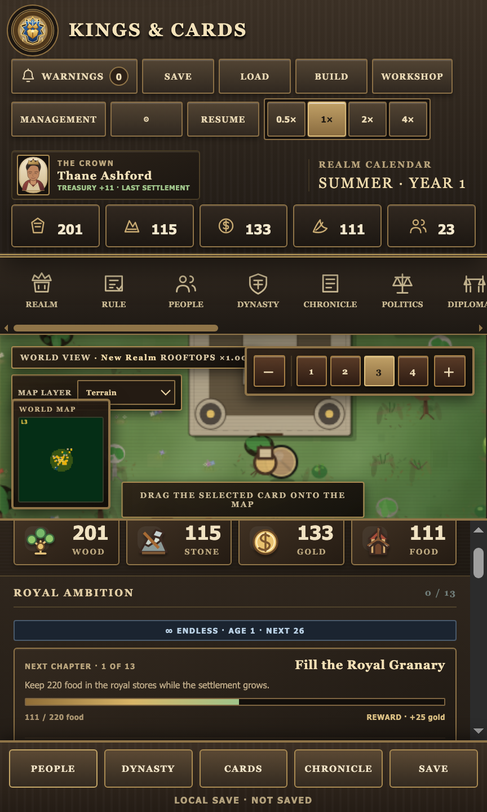

# The Endless Realm

**Status:** implemented on the `3.15.0` line and verified on 2026-11-16.
**Scope:** removal of terminal defeat, the 25-year endless ages, save compatibility, HUD status and the 500-year deterministic proof.

## Why this exists

The authored campaign had two hard endings that survived every post-campaign system:

- morale below 8 after tick 800 set `state.gameOver = true` and stopped the clock;
- destruction of the keep set `state.gameOver = true` and stopped the clock.

The thirteen ambitions, Eternal Deeds and Crown Endeavours gave the mature realm goals, but a bad winter or a lost battle could still terminate a century-old save. A realm is only truly endless when neither event can strand the player.

## Rules

### Endless by default

New realms found through the start screen have **∞ ENDLESS REALM** checked. The checkbox sits under the World Forge and can be unchecked for the classic finite campaign. The choice is stored in `state.endless.enabled`; it is not part of the terrain options, so the world seed and terrain stay identical.

Existing saves without an endless block load with endless enabled. A save that was written at `gameOver: true` resumes as a recoverable realm: `restoreSaveSnapshot` clears the terminal flag for endless realms, and the next morale tick restores the realm.

### Recoverable morale collapse

At morale below 8 after tick 800:

1. `recoverEndlessMorale()` is called instead of setting game over.
2. Morale returns to at least **26**.
3. Legitimacy loses **3**.
4. The collapse and rescue are counted and added to a bounded history.
5. The event log reports `THE REALM ENDURES — A HARSH LESSON`.

A **400-tick cooldown** prevents a starving realm from retriggering the rescue every day. The realm can still be miserable and can collapse again later; the chronicle simply never terminates.

### The keep holds

When a raid reduces the keep to zero health in an endless realm, `holdEndlessKeep()` restores it to **35% of its maximum health**, keeps it alive and records a `keep` history entry. The raid still damages the realm, kills residents and consumes resources, but the crown retains a seat from which to rebuild. In a classic realm the original destruction and game-over path is unchanged.

### Ages

Every **25 years** the realm enters a new endless age. The age is derived from the calendar (`floor((year - 1) / 25) + 1`), not trusted from a stale save. Each new age:

- writes a chronicle entry (`THE 2ND AGE BEGINS …`);
- adds a bounded history record;
- advances the visible HUD status;
- keeps the existing Eternal Deed, Crown Endeavour and ritual loops running.

The HUD line reads `∞ ENDLESS · AGE 21 · NEXT 526` for a year-501 realm. Rescue counts are appended when they exist. A classic realm shows `CLASSIC REALM · FINITE DEFEAT`.

## State and save compatibility

```js
state.endless = {
    version: 1,
    enabled: true,
    age: 1,
    ageStartedYear: 1,
    bestYear: 1,
    collapses: 0,
    rescues: 0,
    keepHolds: 0,
    lastRescueTick: 0,
    history: [] // newest first, capped at 12
};
```

- The block is additive in the existing save schema; no save-version bump is required.
- `normalizeEndlessState()` clamps counts, derives the age from `snapshot.year`, sanitizes history and defaults missing saves to enabled.
- Unknown history kinds, non-finite values and oversized counts are discarded or clamped.
- The save stores the block next to the winter state. `restoreSaveSnapshot` normalizes it before clearing a terminal `gameOver` flag.
- The classic path remains available by unchecking the founding option; it preserves the original terminal behavior exactly.

## Integration and performance

- `simulation.js` calls `updateEndlessRealm()` once per simulation tick and routes the morale-collapse branch through the recovery helper in endless realms.
- `combat.js` interposes only at the keep-destruction branch.
- The normal tick cost is two integer reads and one age comparison. Allocations happen only at an age boundary or a recorded collapse.
- No new frame loop, per-tile scan, entity scan or DOM work was added to the simulation hot path.
- History is capped at 12; event entries use the existing capped event log and timeline.
- The physical entity and map caps are unchanged. They limit how large a realm can grow, not whether the chronicle can continue.

## Long-run proof

Command:

```sh
cd game
ENDLESS_YEARS=500 npm run test:endless
```

Result on seed `20261215`, Snowlands, `common-weal`:

| Measurement | Result |
| --- | --- |
| Horizon | **500 years / 200,040 campaign ticks** |
| Final date | **year 501**, tick 200,161 |
| Endless age | **Age 21**, next age year 526 |
| Ambitions | **13 / 13** |
| Eternal deeds | **16 completed** |
| Population | **56** |
| Living entities | **110** |
| Morale collapses / rescues | **4 / 4** |
| Game over | **false** |
| Tick cost | **1.346 ms/tick** |
| Elapsed | **296,051 ms** |
| Invariants | age/calendar, horizon, entity cap, unique IDs, finite coordinates, finite resources, morale range, bounded history — all true |

The run uses the real fixed-step simulation, starting kingdom, construction, logistics, events, royal house, ambitions and endeavours; only the terrain-prerender canvas is stubbed. Four real morale collapses were recovered, proving the endless path under load rather than only in a unit test. The 250-year gate (`ENDLESS_YEARS=250`) also passes: 100,040 ticks, year 251, age 11, 12 Eternal Deeds and 1.941 ms/tick.

Reproduction writes a JSON record to `artifacts/endless-500y.json` and the audit to `artifacts/ENDLESS_500Y_AUDIT.md`. The production build was also opened at `https://kings-and-cards.pages.dev/`, a new realm founded through the default checked endless contract, and the HUD verified at `∞ ENDLESS · AGE 1 · NEXT 26` with no console messages.



## Limits

- This is a deterministic automation proof, not a human 1,000-hour entertainment proof.
- The post-campaign content remains the existing Eternal Deeds and Crown Endeavours; endless mode removes endings and adds ages, not a new map or rival-realm generator.
- The entity cap, map size and finite resource nodes still bound the physical size of a realm. A fully capped realm continues through deeds, trade, diplomacy, festivals, research and chronicles rather than new construction.
- Classic mode is intentionally still terminal; the default founding checkbox is the endless contract.
