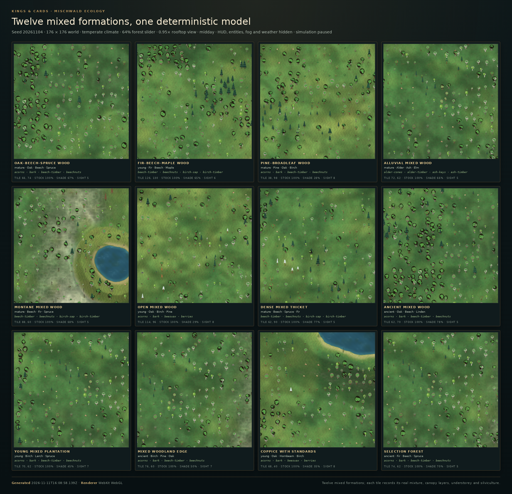
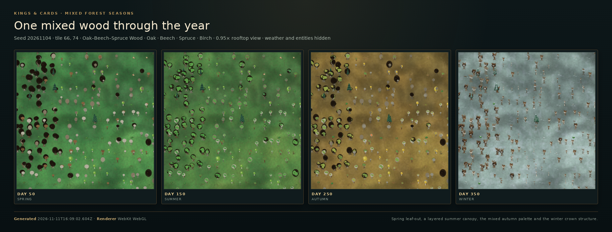

# Mischwälder (1.2.3)

The mixed-forest phase extends the shared woodland model in
[`world/forest-ecology.js`](../js/world/forest-ecology.js). It does not add a
second forest simulator. A mixed stand is still one deterministic result of
seed, moisture, temperature, height, climate, forest cover and stock ratio; the
difference is that the stand now carries a real mixture ratio, a dominant
species, a group or mosaic distribution, an age structure, several canopy
layers, understorey character, phenology, habitat value and silvicultural uses.

The renderer, resource geography, forester survey, seasonal gathering ledger,
fauna and succession all read the same stand. The 1.2.1 and 1.2.2 numeric
formation indices are unchanged; the twelve mixed formations are appended after
the twenty-seven existing formations.

## Species

The forest vocabulary now has **20 species**. The five new mixed-forest species
are real trees, not palette swaps: each has its own bark, crown form, leaf
silhouette, timber good, useful products, understorey preference and seasonal
timing.

| Species | Form | Timber | Character and products |
|---|---|---|---|
| Ash (`ash`) | tall oval, pinnate leaf | `ash-timber` | damp and fertile woods, ash keys, herbs |
| Hornbeam (`hornbeam`) | dense dome, serrated leaf | `hornbeam-timber` | hard coppice wood, seeds, deep shade |
| Rowan (`rowan`) | airy, pinnate leaf | `rowan-timber` | upland edges, rowan berries for wildlife |
| Hazel (`hazel`) | low scrub, round leaf | `hazel-timber` | understorey, hazelnuts, coppice rods |
| Willow (`willow`) | airy, lance leaf | `willow-timber` | wet alluvial banks, withies, early flowers |

The existing oak, beech, birch, maple, chestnut, linden, elm, alder and the
seven conifers keep their original definitions. Every species still declares
its own all-season timber good, so a mixed wood cannot collapse into generic
"wood" in the ledger.

## Twelve mixed formations

| Formation | Mixture | Distribution | Layers | Character |
|---|---|---|---|---|
| `mixed-oak-beech-spruce` | oak 30, beech 24, spruce 20, birch 14, maple 12 | grouped | 3 | old oaks and beech with spruce closing the northern edge |
| `mixed-fir-beech-maple` | fir 32, beech 28, maple 18, spruce 10, birch 12 | grouped | 3 | deep shade, smooth beech bark and brilliant maple autumn |
| `pine-broadleaf` | pine 40, oak 20, birch 16, beech 12, larch 12 | mosaic | 2 | sunlit pines with scattered broadleaf gaps |
| `mixed-alluvial` | alder 24, ash 20, elm 18, willow 14, birch 12, spruce 12 | mosaic | 3 | damp alder–ash–elm–willow with spruce on raised banks |
| `mixed-montane` | beech 24, fir 24, spruce 20, maple 16, rowan 8, birch 8 | grouped | 3 | sheltered beech–fir slope with spruce and rowan above |
| `mixed-open` | oak 26, birch 22, pine 18, maple 14, linden 12, hazel 8 | even | 2 | light wood with a tall grass and herb layer |
| `mixed-dense` | beech 22, spruce 20, fir 14, maple 14, birch 12, hazel 10, yew 8 | grouped | 3 | closed canopy over hazel, bramble and young yew |
| `mixed-ancient` | oak 22, beech 20, linden 16, fir 14, maple 12, elm 10, hornbeam 6 | grouped | 3 | hollow old oaks and lindens among giant firs |
| `mixed-young` | birch 26, larch 18, spruce 16, beech 14, maple 14, oak 12 | even | 2 | young plantation rows with pioneer birch and larch |
| `mixed-ecotone` | birch 20, pine 18, oak 18, beech 14, spruce 12, maple 10, rowan 8 | mosaic | 2 | soft gradient between wood and open country |
| `coppice-with-standards` | oak 34, hornbeam 18, birch 16, hazel 14, linden 10, maple 8 | even | 2 | cut hazel/hornbeam stools under mature oak standards |
| `selection-forest` | fir 24, beech 22, spruce 18, maple 14, oak 12, hornbeam 10 | grouped | 3 | uneven-aged stand worked stem by stem |

The formations still participate in the existing disturbance, regrowth,
gathering, fauna and sight systems. Conifer-specific pests, snowbreak and
drought are now weighted by the actual conifer share: a stand with 15% spruce
does not receive the same outbreak probability as a sprucewood. This keeps the
four-decade disturbance budget under its 15% contract after the mixed area was
added.

## Distribution and regional communities

`formationFor()` uses two independent coarse hashes:

- **mixed influence** decides whether a mixed patch replaces the surrounding
  pure broadleaf/conifer stand;
- **mixed variant** decides which of the twelve communities establishes there.

This keeps pure oak, beech, maple, linden, birch, spruce, fir, pine and larch
formations reachable (the pure-island requirement) while producing natural
gradients. The community also depends on the site:

- cold, high sheltered slopes move from `hillside` into `mixed-montane`;
- wet temperate ground becomes `mixed-alluvial` with spruce on raised banks;
- dry, warm, open ground can become `pine-broadleaf` or `mixed-open`;
- cold, high country still passes into `mixed-conifer`,
  `mountain-conifer` and `subalpine-scrub`;
- `mixed-ancient` and `mixed-young` override the base mixed formation on their
  own age patches.

## What a mixed stand exposes

`forestStandAt()` now returns a first-class `mixture` object plus flat aliases:

| Field | Meaning |
|---|---|
| `mixture.broadleafShare` / `coniferShare` | actual weighted crown-type ratio |
| `mixture.deciduousShare` | broadleaf plus larch, the leaf-shedding share |
| `mixture.dominant`, `dominantShare` | strongest species and its share |
| `mixture.evenness` | normalized Shannon evenness of the species mix |
| `mixture.pattern` | `even`, `grouped` or `mosaic` |
| `mixture.groups` / `tileGroup` | species groups and the group owned by this tile |
| `mixture.ageStructure` | young / mature / ancient shares, uneven-aged flag, spread |
| `mixture.canopyLayers` | emergent, main canopy and understorey bands with height ranges |
| `mixture.crownHeightSpread` | difference between the tallest and shortest species |
| `mixture.understoryType` | grass/herb, bramble, shrub, fern or moss/litter floor |
| `mixture.ecotone` | real wood edge or transition |
| `mixture.lightTransmission` | spring / summer / autumn / winter floor light |
| `mixture.autumnPalette` | distinct species autumn colours in the canopy |
| `mixture.foodPlants` | berries, mast, mushrooms and other wildlife food |
| `mixture.habitat` | fauna count, vegetation layers, food count, deadwood, edge and score |
| `mixture.silviculture` | timber, firewood, charcoal, coppice, veneer, resin, mast, grazing, etc. |
| `mixture.woodQuality` | species, timber weight and young/mature/old-growth grade |
| `mixture.phenology` | flowering and fruiting windows for the species present |
| `mixture.mastCrop` | combined mast potential for swine and wildlife |

`pickSpecies()` respects `tileGroup` for grouped and mosaic stands: a tile
mostly draws from its own species group, while the remaining share still admits
the wider mixture. Evenly mixed stands bypass the group bias. The same rule is
deterministic, so a frame, a survey and a save all replay exactly.

`forestTreeForm()` assigns each tree a canopy layer from the same data. The
renderer therefore has a readable emergent/main/understorey structure instead
of one flat crown height.

## Seasonal ecology

`FOREST_PHENOLOGY` records flowering and fruiting windows for all 20 species.
`forestPhenologyAt()` turns that table into the species actually flowering or
fruiting on a given day, and `forestSurveyAt()` exposes it as
`phenologyNow`. The windows are descriptive and bounded; they do not create a
second saved calendar.

`forestLightTransmissionAt()` returns the seasonal floor light from the same
stand. For a deciduous mixed wood, winter is brightest, then autumn, spring and
the closed summer canopy; a dense fir–beech–maple stand transmits less in
summer than an open mixed wood. The renderer continues to use the existing
`light`, `canopy` and `solid` paths; the survey reads the same values.

The understorey vocabulary gained `grass` and `herb` alongside fern, bramble,
shrub, heather, moss, lichen and berry. The terrain renderer draws real grass
tufts for those layers, so an open mixed wood or a wood-pasture edge no longer
looks like a bare clearing.

## Checklist 1.2.3.1–35

| ID | Requirement | Status | Implementation and evidence |
|---|---|---|---|
| 1.2.3.1 | Oak, beech, birch and spruce combinations | Implemented | `mixed-oak-beech-spruce`; weights and group pattern in `FOREST_TYPES`; `tests/world/mixed-forest.test.js`. |
| 1.2.3.2 | Fir, beech and maple mixtures | Implemented | `mixed-fir-beech-maple` with fir 32 / beech 28 / maple 18. |
| 1.2.3.3 | Pines with scattered broadleaf trees | Implemented | `pine-broadleaf` (pine 40, oak/beech/birch/larch); mosaic pattern. |
| 1.2.3.4 | Different mixing ratios | Implemented | Twelve formations span roughly 12–58% conifer; `mixture.broadleafShare`/`coniferShare`; ratio-set assertion in the mixed test. |
| 1.2.3.5 | Regional communities by climate and soil | Implemented | `formationFor()` gates on temperature, moisture, height and climate; `mixed-alluvial`, `mixed-montane`, `mixed-open`, `pine-broadleaf`; tests compare wet/cool/open samples. |
| 1.2.3.6 | Dominant species inside a mixed stand | Implemented | `mixture.dominant`, `dominantShare`, `dominantSpecies`; groups preserve local dominants. |
| 1.2.3.7 | Different age and size distributions | Implemented | `ageClassFor()` forces `mixed-ancient`/`mixed-young`; `ageStructure`; `forestTreeForm()` height/trunk/crown variation. |
| 1.2.3.8 | Evenly mixed stands | Implemented | `mixturePattern: 'even'` for `mixed-open`, `mixed-young` and `coppice-with-standards`; even stands bypass group bias. |
| 1.2.3.9 | Group-wise species distribution | Implemented | `mixture.groups`, `tileGroup` and grouped `pickSpecies()` preference (74% local group in grouped stands). |
| 1.2.3.10 | Small pure broadleaf and conifer islands | Implemented | Coarse mixed influence leaves pure formations reachable; inside grouped and mosaic mixed stands a 5×5 coarse hash reserves about 10% of tiles as a single-species broadleaf or conifer island, chosen from the actual species pool and exposed as `mixture.pureIsland`; pure oak/beech/maple/spruce/fir/pine/larch formations remain in the same realm. |
| 1.2.3.11 | Different crown heights | Implemented | Species `height` values, `crownHeightSpread`, three canopy layers and per-tree `canopyLayer`; old mixed stands hold a wider spread. |
| 1.2.3.12 | Open areas and dense forest groups | Implemented | `mixed-open` density 0.40 / openness 0.56; `mixed-dense` density 0.90 / openness 0.08; clearings and edges remain real. |
| 1.2.3.13 | Natural transitions between communities | Implemented | `mixed-ecotone`, the coarse influence/variant gates, alluvial/montane gradients and pure-formation islands; no hard biome line. |
| 1.2.3.14 | Different understorey structures | Implemented | `grass`, `herb`, fern, bramble, shrub, heather, moss, lichen and berry; `understoryType`; dense vs open assertions. |
| 1.2.3.15 | Habitat for many animal species | Implemented (simulated) | Formation fauna plus `mixture.habitat` score/layers/food; existing `forest-fauna.js` herds and insects. |
| 1.2.3.16 | Different food plants | Implemented | Species goods feed `mixture.foodPlants` (acorns, beechnuts, hazelnuts, berries, mushrooms, honey); gathering ledger. |
| 1.2.3.17 | Different flowering and fruiting times | Implemented | `FOREST_PHENOLOGY` for all 20 species; `forestPhenologyAt()`; spring hazel catkins and autumn mast assertions. |
| 1.2.3.18 | Different soil and light conditions | Implemented | `ground.soil` (loam, humus, alluvial, dry, podzol), `moisture`, `light`, `groundShade`; seasonal light transmission. |
| 1.2.3.19 | Several vegetation layers | Implemented | Canopy layers, shrub/sapling layer, grass/herb/fern/bramble floor, moss/litter and deadwood; `structure` and `mixture.habitat.layers`. |
| 1.2.3.20 | Evergreen and deciduous crowns mixed | Implemented | Broadleaf/conifer/deciduous shares; larch counted as deciduous; `mixed-oak-beech-spruce` etc. |
| 1.2.3.21 | Different autumn colours | Implemented | Per-species autumn palettes; `mixture.autumnPalette` up to six colours; seasonal foliage timings. |
| 1.2.3.22 | Seasonal light permeability | Implemented | `lightTransmission.spring/summer/autumn/winter`; winter > summer for deciduous stands. |
| 1.2.3.23 | Old, species-rich mixed forests | Implemented | `mixed-ancient`, ancient age bias, seven species, hollows/deadwood/moss; old-growth wood grade. |
| 1.2.3.24 | Young mixed afforestations | Implemented | `mixed-young`, young age bias, birch/larch pioneers, open grass and bramble. |
| 1.2.3.25 | Wet mixed forests | Implemented | `mixed-alluvial`: alder, ash, elm, willow and spruce; high wetness, moss, herbs; `forestWetness`. |
| 1.2.3.26 | Mountain mixed forests | Implemented | `mixed-montane`: beech, fir, spruce, maple, rowan; high-ground gate; adjacent to mountain conifer. |
| 1.2.3.27 | Light-rich mixed forests with tall grass | Implemented | `mixed-open`: grass 0.50, herb 0.30, density 0.40; renderer grass tufts; `understoryType` assertion. |
| 1.2.3.28 | Dense mixed forests with strong understorey | Implemented | `mixed-dense`: bramble 0.24, shrub 0.30, density 0.90; low visibility; shade pass. |
| 1.2.3.29 | Near-natural stands | Implemented | `selection-forest`: uneven-aged fir/beech/spruce/oak/hornbeam, three layers, selection-felling use. |
| 1.2.3.30 | Different wood types and qualities | Implemented | 20 distinct species timbers; `mixture.woodQuality` with young/mature/old-growth grades and timber weights. |
| 1.2.3.31 | Berries, nuts and mushrooms | Implemented | Rowan berries, elderberries, hazelnuts, hornbeam seeds, acorns, beechnuts, chestnuts, mushrooms, truffles; seasonal table and gathering. |
| 1.2.3.32 | Medicinal plants and herbs | Implemented | Herbs, woodruff, valerian, tinder fungus; existing `applyHerbalRemedy()` consumes stored herbal stock. |
| 1.2.3.33 | Hunting and gathering areas | Implemented | Formation fauna, real herd offtake, game/fur/hides and the forest gathering ledger. |
| 1.2.3.34 | Firewood and tree products | Implemented | Firewood, charcoal, per-species timber, resin, cones, withies and mast; delivery into the physical economy. |
| 1.2.3.35 | Different forestry uses | Implemented | `SILVICULTURE_USES` and per-formation use lists: timber, firewood, charcoal, coppice, poles, veneer, resin, mushrooms, hunting, mast, grazing, basketry, medicine, honey, protection, selection felling. |

## Beyond the 35 points

- **Twelve new formations**, not one generic "mixed" type, and five new species
  integrated into the existing ecology.
- **A mixture object on every stand**, with ratios, dominant species, evenness,
  groups, tile group, age structure, canopy layers, crown-height spread,
  understorey type, ecotone, light transmission, autumn palette, food plants,
  habitat score, silviculture, wood grades, phenology and mast crop.
- **Group-wise rendering** through `pickSpecies()`, so mixed woods read as
  patches of species rather than uniform salt-and-pepper.
- **Small pure islands** inside grouped and mosaic mixed stands: a deterministic
  5×5 cell can hold a single broadleaf or conifer species, while even mixtures
  keep their even distribution.
- **Canopy layers per tree** through `forestTreeForm().canopyLayer`.
- **Real grass and herb layers** drawn by the terrain renderer.
- **Climate/soil regionality** through the formation gates and alluvial/montane
  variants.
- **Share-weighted conifer hazards**: a mixed wood with a minority of spruce no
  longer receives a pure-spruce outbreak probability. This is the cause fix
  behind the four-decade disturbance budget staying below 15%.
- **Control parties now price bark-beetle, snowbreak and drought**, so no
  disturbance is free to contain.
- **New forest goods** (ash keys, hornbeam seeds, rowan berries, hazelnuts,
  willow withies, woodruff, valerian, tinder fungus, elderberries) with real
  delivery paths into food, gold or local stores.
- **A dedicated visual reference** for all twelve mixed formations and one
  mixed stand through four seasons.

## Visual reference

Generated with the existing reference harness:

```bash
cd game
npm run test:mixed-reference
```

The run starts the fixed temperate realm (seed `20261104`, 176 × 176, 64%
forest cover), finds one real generated tile for every mixed formation, captures
all twelve at the same 0.95× rooftop view and follows one oak–beech–spruce stand
through days 50, 150, 250 and 350. The metadata records each tile's actual
mixture, pattern, broadleaf/conifer shares, canopy layers, understorey,
silviculture and winter goods; the artifact hashes are in the JSON.





## Browser verification (2026-11-11)

The mixed profile was re-run through the real browser renderer on the fixed
reference world (seed `20261104`, temperate, 176 × 176, 64 % forest cover) with:

```bash
cd game
FOREST_REFERENCE_PROFILE=mixed FOREST_REFERENCE_OUT="$PWD/artifacts/mixed-browser-verify" npm run test:mixed-reference
```

The Chromium/Playwright harness captured all twelve formations at the same
0.95× rooftop view and one oak–beech–spruce stand on days 50, 150, 250 and 350.
The renderer reported `WebKit WebGL` at 800 × 800. The fresh metadata was
compared field-by-field with the tracked
[`mixed-reference.json`](terrain-reference/mixed-reference.json): **12/12
formations matched, with 0 mismatches across 372 field comparisons (31 per
formation)**; seed, world, renderer, seasonal focus and seasonal days also
matched exactly.

The contact sheet and seasonal strip were inspected visually. Every formation
panel and all four seasons were present and rendered through the production
terrain path; there was no missing tile, Canvas2D fallback, ground-only
formation panel or blank seasonal frame. Each capture waits for the decoration
overlay cache to rebuild after the camera move instead of relying on a fixed
timeout, so a slow software renderer cannot save the frame before its trees are
composited. The lighter `pine-broadleaf` and `mixed-open` frames reflect their real
open canopy (`treeChance` 0.444 and 0.318), not missing formation art. The
fresh outputs are review artifacts under `artifacts/mixed-browser-verify/` and
are not committed; the tracked reference remains the canonical evidence.

## Verification

- Full `npm test`: **751/751** including the new
  `tests/world/mixed-render-identity.test.js` guard and the century pure-island
  save/reload test.
- Focused mixed/forest suite: **42/42**
  (`mixed-forest`, `mixed-forest-longrun`, `forest-ecology`, `conifer-forest`,
  `forest-succession-longrun`).
- Century pure-island gate: 100 simulated years / 40,000 daily succession and
  regrowth steps with a real resource + succession save/reload every ten years;
  65 islands (49 broadleaf, 16 conifer) on day zero, 63 still present after the
  century, and **0** stand or succession fingerprint mismatches across all ten
  reloads. `tests/world/mixed-forest-longrun.test.js`.
- Deterministic 25-year campaign: **`ok:true`**, **10,040 ticks**,
  **13/13 ambitions**, no game over, **0.807 ms/tick** on this head.
- Syntax and relative imports: **105 source files**, **189 UI ids**.
- Mixed visual reference: **12/12 formations**, four seasons, WebKit WebGL,
  exit 0; the artifact hashes match the generated PNGs.
- Focused regressions also cover forest fauna, gathering, succession control,
  seasonal foliage and the shared sight/occlusion contract.

## Deliberate limits

- Pure islands are deliberately limited to grouped and mosaic stands; evenly
  mixed stands remain even, so 1.2.3.8 is not undone by 1.2.3.10.
- Habitat value and fauna are derived from the stand/formation data and the
  existing fauna model; there is no separate AI for every animal species.
- Soil is derived from site moisture, formation and stand structure into
  `ground.soil`; there is no separate soil-type raster.
- A mixed stand is a deterministic tile model, not a per-stem forest
  inventory. Group membership is a coarse tile-scale pattern, not a spatial
  tessellation of individual crowns.
- `mixture.evenness` is a descriptive diversity measure; it does not drive a
  separate competition solver.
- Phenology windows are a shared calendar table, not saved per-tree flowering
  events.
- Silviculture lists real possible uses; it does not simulate a player-owned
  felling schedule or a timber auction.
- The reference sheet is a human-review artifact, not a pixel-diff test. It
  proves the code paths and the recorded mixture data, not target-GPU colour or
  frame time.
