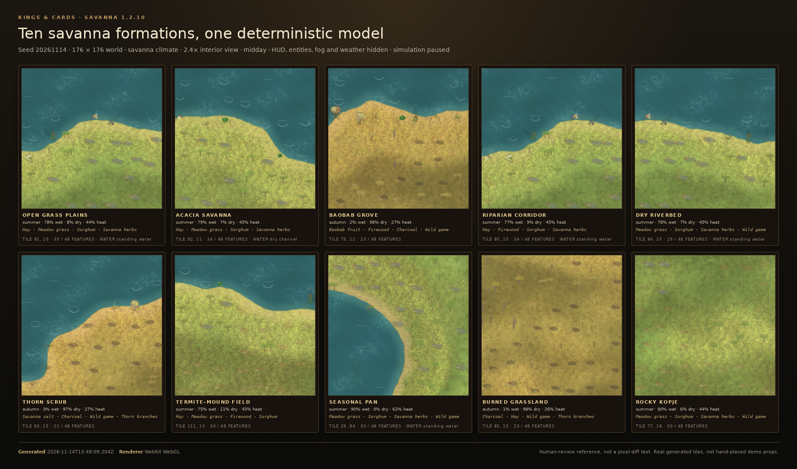
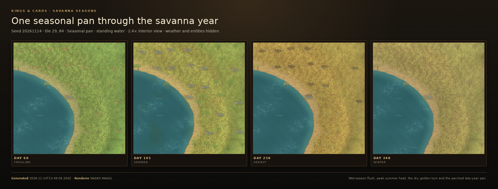

# Savanna 1.2.10

Savanna is a fire-shaped, grazing-shaped landscape with a strong wet/dry pulse,
not dry grassland with a few trees painted on it. `game/js/world/savanna-ecology.js`
derives one deterministic profile from height, moisture, temperature, climate,
season, weather, wind and real land use. The same profile feeds terrain colour
and detail, gathering, farm/stable surveys, movement costs and the shared good
ledger. There is no extra tick loop, no per-tile save data and no parallel
inventory.

## Implementation

- **Ecology:** `savanna-ecology.js` with `savannaPotentialAt()`,
  `isSavannaSite()`, `savannaProfileAt()`, `savannaGoodsFor()`,
  `savannaProductsAt()`, `savannaSummary()` and `savannaRequirement()`.
- **Climate:** dedicated `savanna` climate (terrain palette, temperature,
  moisture and a no-snow wet/dry seasonal profile). Existing temperate, arid,
  tropical, steppe, desert and tundra worlds keep their current behaviour, so
  old saves render unchanged.
- **Soil and landform:** laterite, nutrients, drainage, erosion, salinity,
  broad plains, rolling low ridges, rocky kopjes, dry sand channels, seasonal
  pans and flood risk. These are profile values, not a colour tint.
- **Water:** separate wet-season and dry-season strength, seasonal wetlands,
  shallow pans, residual waterholes, standing water and dry riverbeds. Water
  scarcity and flash-flood risk are both derived, so the same tile can swing
  between dust and flood.
- **Vegetation:** tall and short grazing grasses, fire-adapted grasses, acacia
  and other flat-crowned trees, baobab and water-storing trees, thorn shrubs,
  seasonal herbs and short-lived rain flowers. Tree cover stays open; savanna
  never receives a closed forest canopy.
- **Fauna:** elephant, giraffe, zebra, wildebeest, impala, gazelle, lion,
  cheetah, hyena, vulture, ostrich, guinea fowl, termites, dung beetles and
  baboons, with herd counts, seasonal presence and migratory behaviour.
- **Goods:** sorghum, millet, gum arabic, marula fruit, baobab fruit and fibre,
  savanna salt, savanna herbs, thorn branches, ivory and bone, charcoal,
  termite earth, thatching grass, meat and five timber grades. Shared meat,
  hides, game, firewood, timber, hay, thatch, stone and wool stay in the one
  catalogue.
- **Terrain:** `terrain.js` gives savanna priority over desert, steppe and
  grassland and suppresses closed forest. `savanna-render.js` draws the bounded
  red-soil ground, cracked pan, tall and short grass, umbrella crowns, swollen
  baobab trunks, thorn scrub, termite spires, waterholes, flowers, fire ash,
  dust and a few wildlife silhouettes. Low savanna is treated as grass and pan,
  not a coastal reed bank, so its ground and trees remain visible.
- **Timber:** `resource-geography.js` seeds sparse savanna woodland across the
  grassy belt as well as the slopes above the closed-forest line (up to 90
  units, roughly 4 % of the map). A lowland savanna start therefore has real
  logs, lumberjacks and firewood without becoming closed woodland. The shared
  forest stock and hauling systems are used; the terrain layer never paints a
  closed canopy.
- **Gathering:** `gatherMeadowProducts()` and
  `gatherNearestGrasslandProducts()` check savanna after tundra and before
  desert. Sorghum, millet, marula, baobab fruit and meat deliver food; savanna
  herbs deliver medicine; gum arabic, salt, thorn branches, termite earth,
  charcoal, ivory, fibre and thatch sell through the existing ledger.
- **Economy:** wet-season growth and dry-season spoilage, a lower harvest
  factor, pastoral and grain value, seasonal movement costs, building material,
  fuel, salt and remote-supply costs. Savanna homes also carry a longer
  hearth-load interval because dry savanna winters are mild rather than
  freezing.
- **Settlements:** `grasslandSiteSummaryAt()` returns the savanna survey for the
  existing farm/stable panel. No new button or resource model is needed.

## Formations

| Formation | Character |
| --- | --- |
| Open grass plains | A broad golden sea of grass with distant herds |
| Acacia savanna | Flat-crowned acacias spaced across tall grass and grazing lawns |
| Baobab grove | Massive water-storing trunks and bare, root-like crowns |
| Riparian corridor | A green ribbon of fever trees and reed beds along a seasonal river |
| Dry riverbed | Pale sand, cracked mud and root-washed banks holding hidden water |
| Thorn scrub | Dense wait-a-bit thorn and raisin bush over short grazed turf |
| Termite-mound field | Red earth spires, close-cropped lawns and enriched grass rings |
| Seasonal pan | A shallow clay basin that turns from dust to mirror to mud |
| Burned grassland | Black ash, charred stems and the first bright green regrowth |
| Rocky kopje | Piled granite boulders, deep shade and a thin grass/scrub fringe |

## 48-point audit

| ID | Implementation |
| --- | --- |
| 1.2.10.1 | Red oat, Guinea, thatching and other tall grasses |
| 1.2.10.2 | Star grass, buffalo grass and short grazing lawns |
| 1.2.10.3 | Scattered trees in every wooded formation; open plains remain open |
| 1.2.10.4 | Umbrella acacia and camelthorn, with a guaranteed umbrella acacia in the acacia formation |
| 1.2.10.5 | Baobab and marula; every baobab grove contains its namesake |
| 1.2.10.6 | Wait-a-bit thorn, sickle bush and raisin bush |
| 1.2.10.7 | Seasonal rain flowers driven by the wet-season bloom |
| 1.2.10.8 | Fire-adapted grasses and the burned-grassland formation |
| 1.2.10.9 | `landform.flat` and broad plains |
| 1.2.10.10 | `landform.hill`, relief and rolling low ridges |
| 1.2.10.11 | `landform.kopje`, rocky outcrops and the rocky-kopje formation |
| 1.2.10.12 | Dry riverbed, dry sand channel and cracked mud |
| 1.2.10.13 | Seasonal wetland and pan strength |
| 1.2.10.14 | Waterhole and residual pool strength, depth and standing-water label |
| 1.2.10.15 | Wet-season pulse in climate, vegetation and goods |
| 1.2.10.16 | Long dry season in climate, grass cover, fuel and water scarcity |
| 1.2.10.17 | High daytime heat and heat risk |
| 1.2.10.18 | Recurring drought state and failed-pasture risk |
| 1.2.10.19 | Strong wet-green to dry-gold seasonal colour change |
| 1.2.10.20 | Green flush after rain in `vegetation.greenFlush` and the palette |
| 1.2.10.21 | Golden dry-season grass in `vegetation.dryGold` and the palette |
| 1.2.10.22 | Wildebeest, zebra and other herd counts |
| 1.2.10.23 | Elephant herds |
| 1.2.10.24 | Giraffe |
| 1.2.10.25 | Impala and gazelle |
| 1.2.10.26 | Zebra |
| 1.2.10.27 | Lion and cheetah |
| 1.2.10.28 | Hyena |
| 1.2.10.29 | Vulture |
| 1.2.10.30 | Ostrich and guinea fowl as ground birds |
| 1.2.10.31 | Termites and counted mound fields |
| 1.2.10.32 | Seasonal wildlife migration in fauna and `seasonalMovement` |
| 1.2.10.33 | Sorghum, millet and grain values |
| 1.2.10.34 | Cattle/adapted livestock value, grazing use and pastoralism |
| 1.2.10.35 | Hides and leather from the shared hunt catalogue |
| 1.2.10.36 | Meat and animal products from the shared hunt catalogue |
| 1.2.10.37 | Scattered timber and fuel; sparse woodland resource nodes |
| 1.2.10.38 | Gum arabic and tree resin |
| 1.2.10.39 | Savanna herbs as medicine |
| 1.2.10.40 | Savanna salt and mineral-lick value |
| 1.2.10.41 | Ivory, bone and horn |
| 1.2.10.42 | Grass-fire risk, fire season, ash and burned formation |
| 1.2.10.43 | Drought risk and failed pasture |
| 1.2.10.44 | Heat risk and heat exhaustion |
| 1.2.10.45 | Predator danger from lions, cheetahs and hyenas |
| 1.2.10.46 | Limited and distant water through water scarcity and supply cost |
| 1.2.10.47 | Flash-flood risk in the wet season and on pans |
| 1.2.10.48 | Livestock disease and biting flies through tsetse and disease risk |

## Tests

- `tests/world/savanna-ecology.test.js`: all 48 requirements, ten formations,
  deterministic survey, seasonality, fauna, goods and delivery channels.
- `tests/presentation/savanna-render.test.js`: all formations render with finite
  coordinates and a bounded call count; trees and null inputs are safe.
- `tests/world/savanna-resource.test.js`: savanna woodland exists, stays under
  6 % of the map, uses only the savanna identity and never exceeds 90 units.
- `npm run test:savanna-reference`: deterministic browser reference with ten
  formations and one seasonal pan through four seasons.

Reference metadata: `docs/terrain-reference/savanna-reference.json` (seed
20261114, 176 × 176 world, WebKit WebGL, formation tiles and SHA-256 hashes).

## Verification

- Focused savanna ecology, rendering and resource tests: **12/12**.
- Full `npm test`: **945/945**, syntax/relative imports clean for **145 source
  files / 203 UI ids**.
- Browser E2E: green, including the world forge, real drag placement, gathering,
  production, ecology save/load, legacy save and large order, with no page
  errors.
- 25-year temperate campaign: 10,040 ticks, 13/13 ambitions, no stalls, no game
  over, 0.830 ms/tick.
- 25-year savanna campaign seed sweep (`20261106`, `20261143`, `20261152`):
  10,040 ticks on every seed, **all real campaign requirements true**, 13/13
  ambitions, no stalled sites, no game over, 0.605–0.619 ms/tick. Across the
  sweep the ordinary health simulation produced **2 real illness-to-
  fuel-backfill orders** on seed `20261152` (in 2 phases, at most one order per
  phase) after a sawyer fell ill in years 7–8 and the normal workforce logic
  replaced them. The earlier `20261106` seed remains green but has zero orders;
  the runner requires the rare chain only somewhere in the documented sweep.
  Run `npm run test:campaign:sweep`; requirements and evidence are recorded in
  [CAMPAIGN_VERIFICATION.md](CAMPAIGN_VERIFICATION.md).
- The browser reference captured all ten formations and the pan at days 60,
  145, 250 and 340 on WebKit WebGL at 800 × 800.

## Deployment

Runtime commit `89ad0ca` (1.2.11) was built to 322 files / 7.65 MiB and
deployed from its exact build directory. Preview receipt
`4dda27c7-f04f-41db-8349-90b4f2c82f70` (2026-11-14 15:35:23–15:35:27Z) and
production receipt `97ac77cd-16f2-433c-a9a8-3eb213214d32`
(15:35:37–15:35:40Z) both succeeded; both environments report
`published:true`. At runtime deployment, both origins served `version.json` for
`89ad0ca`; the documentation build adds only this record and keeps the same
runtime package. The `terrain.js`, `savanna-ecology.js`, `savanna-render.js`
and `terrain-model.js` SHA-256 hashes match the built package. Live production and
preview loads each exposed all eight climate options (Temperate, Northern,
Tundra, Savanna, Mediterranean, Arid, Enchanted, Tropical rainforest), loaded
every requested script and stylesheet with HTTP 200, and reported no page or
console errors beyond the expected software-WebGL `ReadPixels` warning.

The previous 1.2.10 runtime (`6386544`, 322 files / 7.64 MiB) was deployed from
its exact build with preview receipt `a0c421fb-f643-421f-8d34-4817f0b0e644`
and production receipt `b74bdc0a-b8c8-4d66-8fe5-eb21ef7ac538`; both
environments also reported `published:true`.
