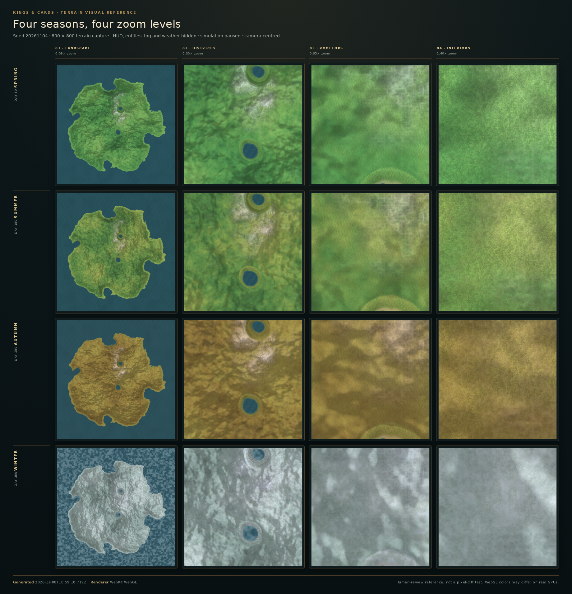
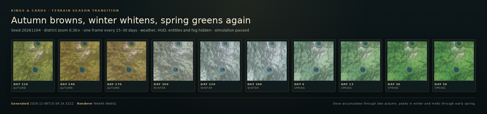
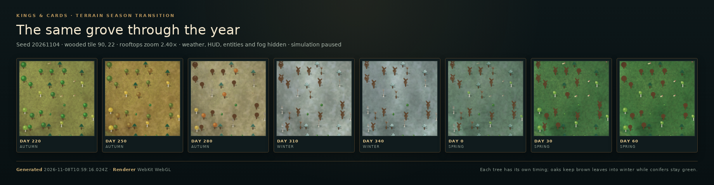
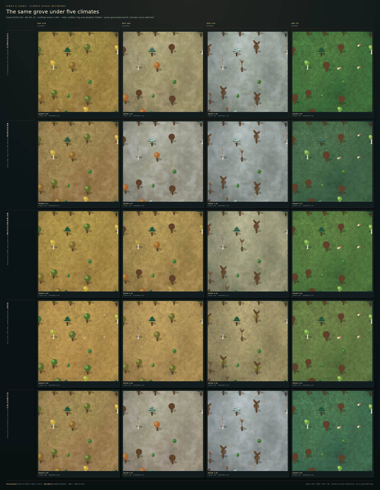
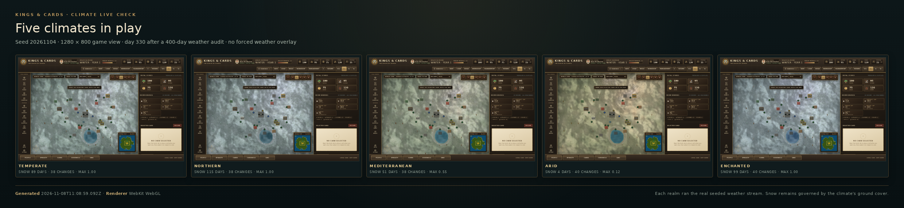

# Terrain visual reference











These sheets are the committed visual baseline for the terrain surface. They complement the numerical atlas tests, the full-year audit and the terrain benchmark: the tests protect determinism, seams and detail data, the sheets make the seasonal, zoom-dependent and per-tree appearance reviewable at a glance, and [`season-year.json`](terrain-reference/season-year.json) records the actual weather and foliage sequence behind them. [`climate-reference.json`](terrain-reference/climate-reference.json) and [`climate-live.json`](terrain-reference/climate-live.json) hold the measured climate comparison behind the two climate sheets.

## What it shows

- **Four seasons at their peak:** spring (day 50), summer (day 150), autumn (day 250) and winter (day 350). Days 0, 100, 200 and 300 are transition days between two anchored season palettes, so the old 0/100/200/300 captures were no longer the peak.
- **Four zoom presets:** landscape (0.09×), districts (0.30×), rooftops (0.95×), interiors (2.40×).
- **Autumn → winter → spring strip:** district zoom, days 210, 240, 270, 300, 330, 360, 0, 15, 30 and 50. It shows the ground browning through autumn, whitening as snow accumulates, and melting back to green through early spring.
- **The same grove through the year:** rooftops zoom (2.40×) on a wooded tile, days 220, 250, 280, 310, 340, 0, 30 and 60. Neighbouring trees turn at different times, deciduous crowns go bare, marcescent oaks hold brown leaves into winter and conifers stay green under snow.
- **Five climates, one grove:** `climate-reference.png` fixes the generated world, seed, grove tile and 2.40× camera and switches only the climate profile. Rows are temperate, northern, mediterranean, arid and enchanted; columns are days 250, 280, 310 and 50. Snow cover, autumn turn and retained leaves are therefore directly comparable across profiles.
- **Live climate check:** `climate-live.png` and `climate-live/<climate>.png` are five real 1280 × 800 game views on day 330, each after its own 400-day weather audit and captured with clear skies. `climate-live.json` records the measured snow days, weather changes, maximum snow cover, and day-30/day-330 foliage samples.
- **Bare crowns and conifers:** the grove strip shows tapered bare branches, twigs and snow resting on branch tips; conifers keep four needle tiers with snow accumulated and shed per tier, plus clumps on the outer tips.
- **The full-year log:** `season-year.json` covers days 0–399 with the real seeded weather stream. It records every day's weather and remaining spell length, ground snow cover, and the leaf, turn, snow, bare and holding state of broadleaf, birch, oak, beech, conifer and shrub samples across seven tree seeds. A climate comparison block places all five profiles on the same timeline.
- Fixed seed `20261104`, a paused simulation and a centred camera. The sheets use the temperate baseline; the log also compares the northern, mediterranean, arid and enchanted profiles.
- HUD, entities, fog of war and weather are hidden so only the terrain surface and its decorations remain.

The reference intentionally uses a fixed camera and a square 800 × 800 terrain surface. It is not a gameplay screenshot and does not assert a particular composition; it is a repeatable surface reference.

## Regenerate

From `game/`:

```sh
npm run test:e2e:setup   # once, installs the pinned Chromium
npm run test:terrain-reference
```

The script:

1. Starts the game with seed `20261104` and an 800 × 800 viewport.
2. Pauses the simulation, reveals the full map and hides the HUD, entities, weather and fog.
3. Captures each season at each zoom preset, the transition strip at district zoom and the grove strip at rooftops zoom.
4. Writes `contact-sheet.png`, `season-transition.png`, `tree-seasons.png` and `reference.json` into `docs/terrain-reference/`.
5. Writes the sixteen individual season frames to `$TMPDIR/kac-terrain-reference-frames` by default. The transition and grove frames are composited directly into their sheets. Set `TERRAIN_REFERENCE_FRAMES` to keep frames somewhere else; set `TERRAIN_REFERENCE_OUT` to redirect the reference artifacts.

The full-year audit is a separate command:

```sh
npm run test:season-year
```

It starts the same seed, pauses the simulation, resets the weather stream and simulates days 0–399 through the real `updateWeather()` code. It writes `docs/terrain-reference/season-year.json` (or `$SEASON_YEAR_OUT`) with the daily log, weather-change events and the five-climate comparison. The run fails if summer contains snow, the year has no snow at all, weather changes fewer than 20 times, a conifer ever goes bare, oaks never hold leaves, broadleaf trees never go bare, or the northern/arid snow timing does not differ from the temperate baseline.

The climate reference is another separate command:

```sh
npm run test:climate-reference
```

It starts one temperate realm for the matrix, pauses it and hides the HUD, entities, weather and fog, then captures the same grove at all five climate profiles on days 250, 280, 310 and 50. It then starts five separate realms, runs 400 real `updateWeather()` days in each, leaves them on day 330 with clear skies and captures the five live views. The command writes `climate-reference.png`, `climate-reference.json`, `climate-live.png`, `climate-live.json` and `climate-live/<climate>.png`. It fails if the audit sees summer snow, fewer than ten weather changes, no oak marcescence at day 330, a northern realm that is not snowier than an arid one, or conifers that do not retain more snow than birches at day 30. Set `CLIMATE_REFERENCE_OUT` to redirect these artifacts.

The GitHub browser workflow runs the terrain, season-year and climate commands with their output directories pointing at `$RUNNER_TEMP/terrain-reference` and uploads the contact sheet, transition sheet, grove sheet, reference and year metadata, both climate sheets, both climate logs and the five individual live screenshots as the `kings-and-cards-terrain-reference` artifact. All three steps run even when the gameplay E2E step fails, so the surface report remains available for review.

The Playwright environment variables described in [tests/browser/README.md](../tests/browser/README.md) apply.

## Limits

- The sheets are captured with Chromium's available WebGL renderer. In the cloud workspace that is software rendering, so colours and fine contrast can differ from a real GPU. The checked-in images are human-review artifacts, not pixel-perfect assertions.
- The grove strip is one wooded tile, chosen by moisture and temperature. It shows the species mix present there, not every tree in the realm.
- The full-year log samples seven fixed tree seeds per species and pauses the simulation, so it measures the seasonal system rather than a specific live realm's full tree population. It does not render weather particles.
- The climate matrix reuses one generated world and camera; it is a direct seasonal comparison, not a population sample. The live sheet uses one realm per climate at the fixed seed and captures clear weather after the audit so the ground snow stays legible; falling-snow particles are not part of these images. Neither climate sheet measures frame time or proves real-GPU appearance.
- The reference does not record frame time. Use [TERRAIN_PERFORMANCE.md](TERRAIN_PERFORMANCE.md) for performance measurements.
