# Terrain visual reference

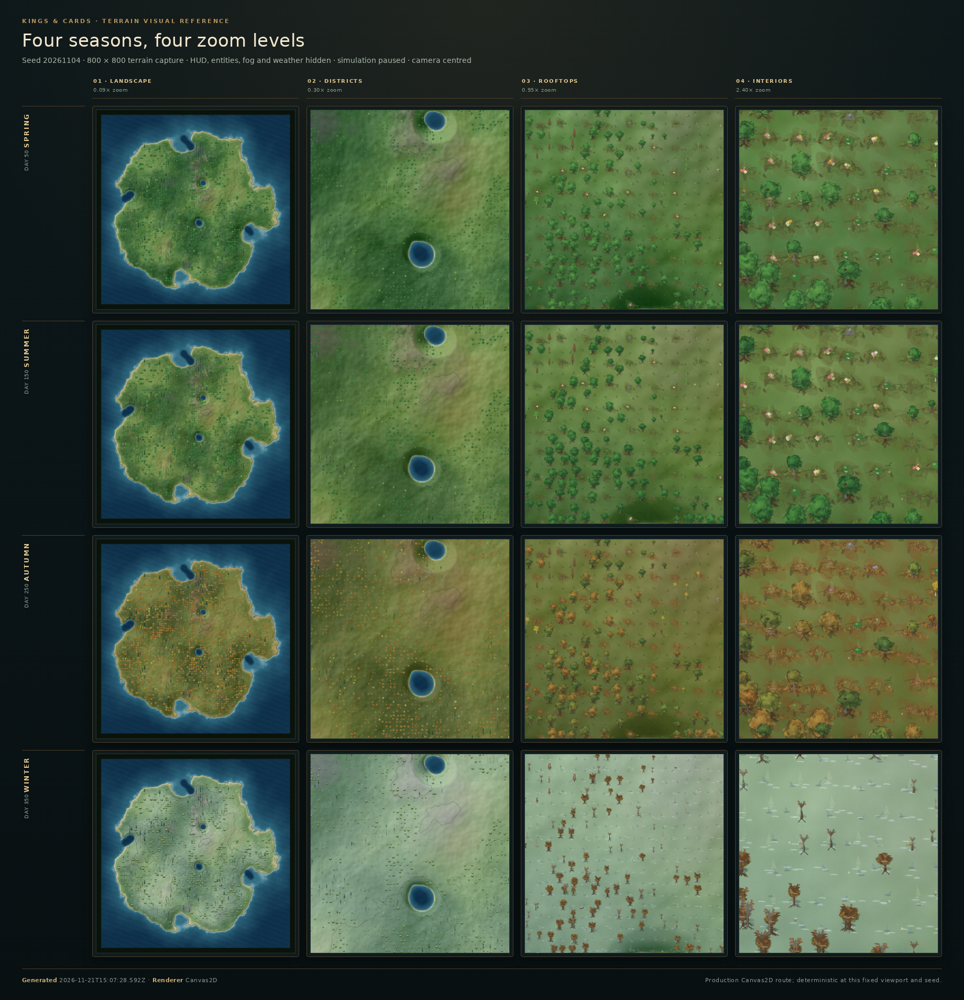

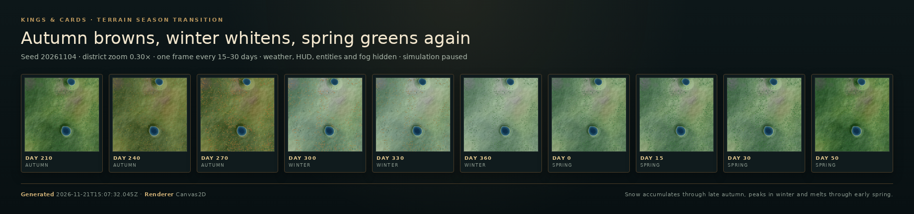

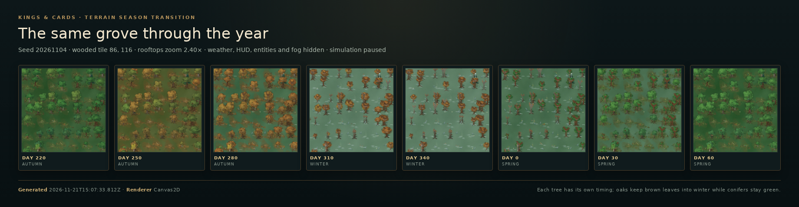

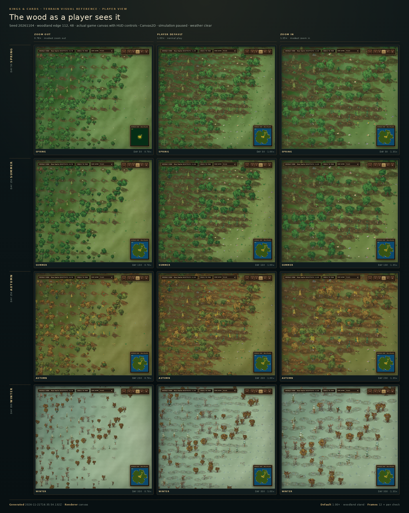

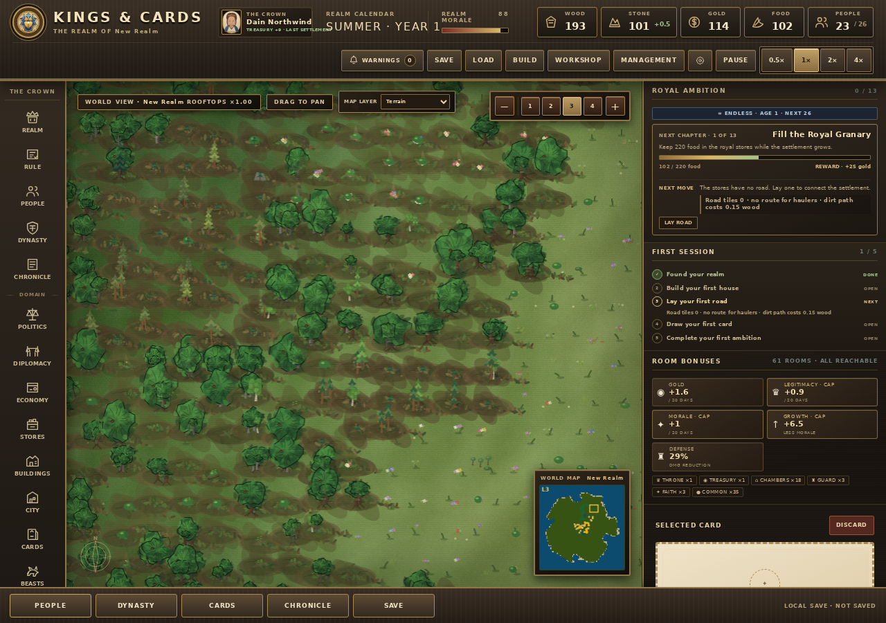

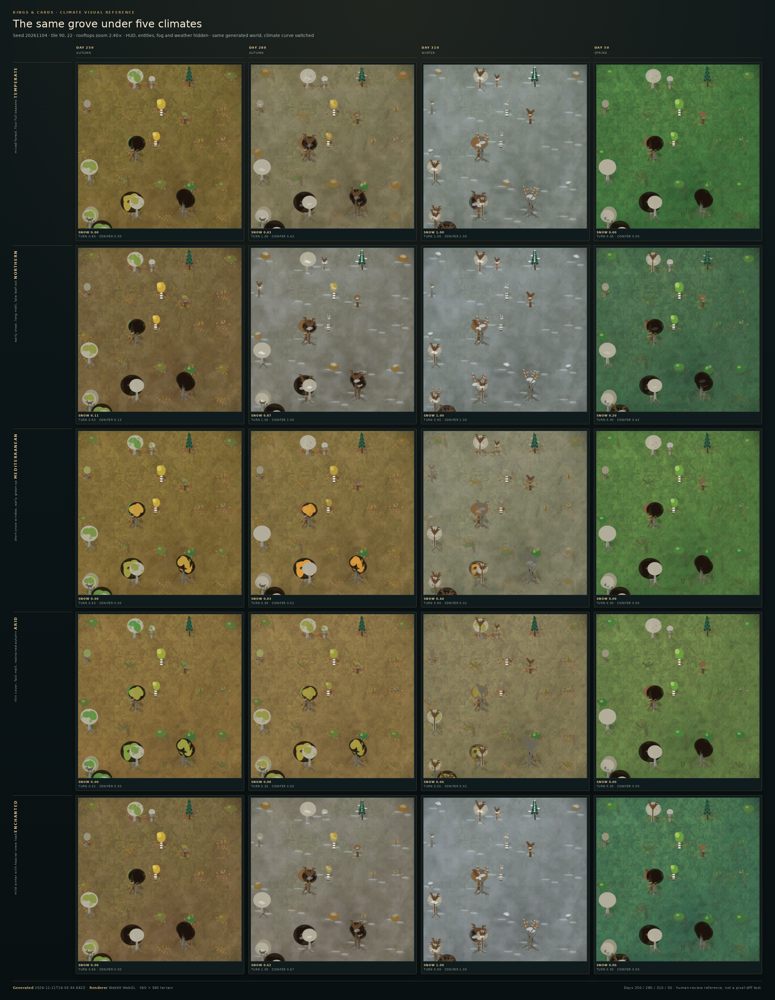

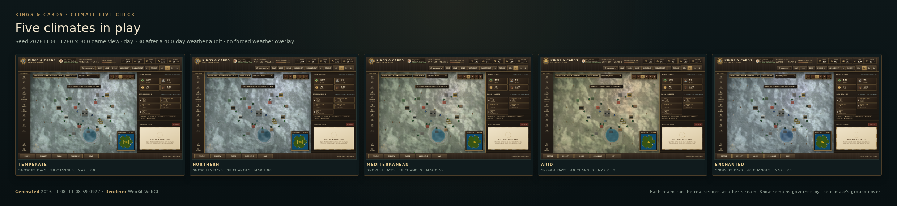

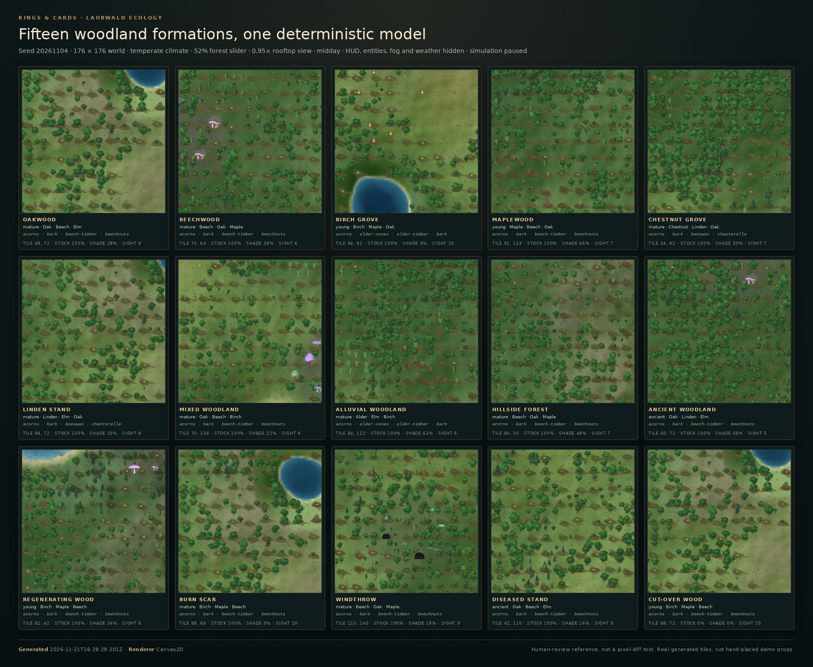

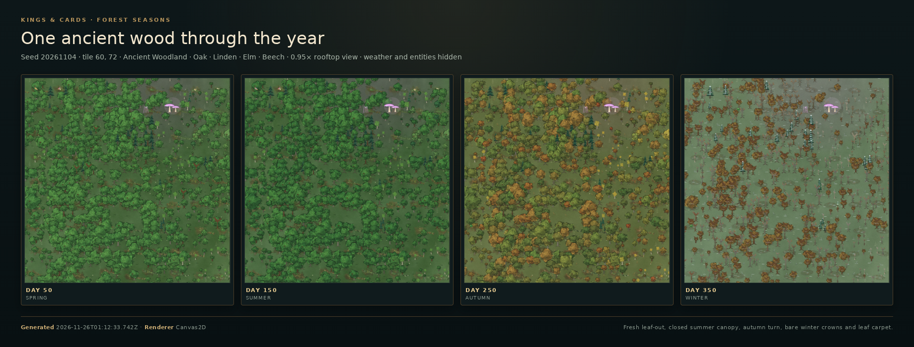

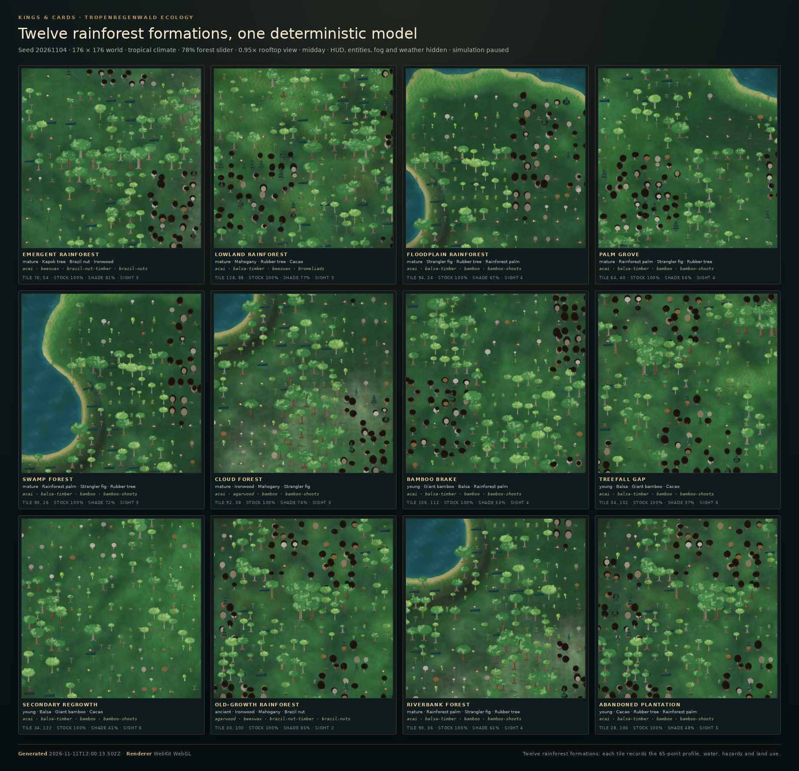

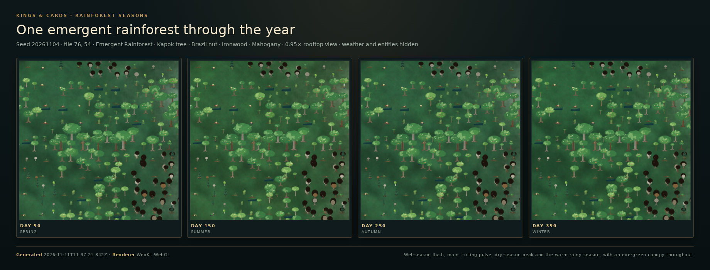

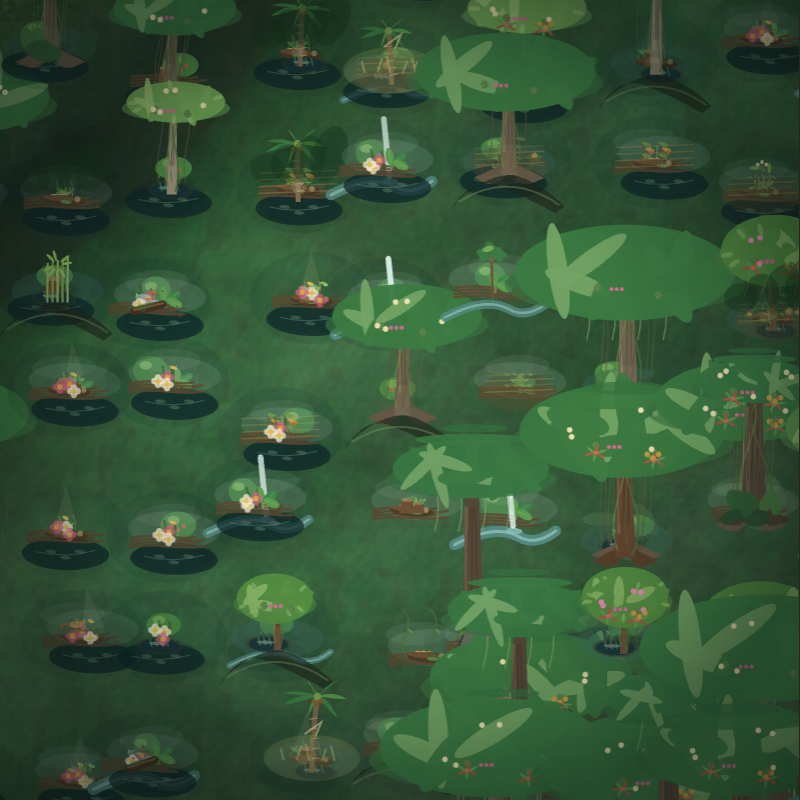

These sheets are the committed visual baseline for the terrain surface. They are generated with the production Canvas2D renderer; set `TERRAIN_REFERENCE_RENDERER=webgl` only when auditing the optional WebGL atlas path. They complement the numerical atlas tests, the full-year audit and the terrain benchmark: the tests protect determinism, seams and detail data, the sheets make the seasonal, zoom-dependent and per-tree appearance reviewable at a glance, and [`season-year.json`](terrain-reference/season-year.json) records the actual weather and foliage sequence behind them. [`climate-reference.json`](terrain-reference/climate-reference.json) and [`climate-live.json`](terrain-reference/climate-live.json) hold the measured climate comparison behind the two climate sheets. [`forest-reference.json`](terrain-reference/forest-reference.json) records the exact tile, species mix, age, goods and fauna behind each of the fifteen forest formations.

## What it shows

- **The player's seat:** `player-view.png` is the missing normal-play proof. It starts a real game with seed `20261104`, keeps the HUD and map controls, and captures one dense woodland edge at `112,48` on days 50, 150, 250 and 350. Columns are the actual player default `1.00×`, a modest `0.78×` zoom-out and a `1.35×` zoom-in. `player-view-hero.png` shows the full default screen, including the HUD. At `1.00×` the crowns keep irregular overlapping silhouettes, broken dark ink contours and internal pen hatching; the floor is brown humus and leaf litter rather than lawn; the right side opens into grass. `player-view.json` records the camera, canvas, focus and a three-tile pan rebuild check. This sheet is intentionally not a 2.4× inspection capture.
- **Four seasons at their peak:** spring (day 50), summer (day 150), autumn (day 250) and winter (day 350). Days 0, 100, 200 and 300 are transition days between two anchored season palettes, so the old 0/100/200/300 captures were no longer the peak.
- **Four zoom presets:** landscape (0.09×), districts (0.30×), rooftops (0.95×), interiors (2.40×).
- **Autumn → winter → spring strip:** district zoom, days 210, 240, 270, 300, 330, 360, 0, 15, 30 and 50. It shows the ground browning through autumn, whitening as snow accumulates, and melting back to green through early spring.
- **The same grove through the year:** rooftops zoom (2.40×) on a real inland ancient-woodland tile, days 220, 250, 280, 310, 340, 0, 30 and 60. Neighbouring trees turn at different times, deciduous crowns go bare, marcescent oaks hold brown leaves into winter and conifers stay green under snow. The tile is chosen from a forest stand, not from a meadow with scattered trees, so the hand-drawn canopy and floor are the actual production passes.
- **Five climates, one grove:** `climate-reference.png` fixes the generated world, seed, grove tile and 2.40× camera and switches only the climate profile. Rows are temperate, northern, mediterranean, arid and enchanted; columns are days 250, 280, 310 and 50. Snow cover, autumn turn and retained leaves are therefore directly comparable across profiles.
- **Live climate check:** `climate-live.png` and `climate-live/<climate>.png` are five real 1280 × 800 game views on day 330, each after its own 400-day weather audit and captured with clear skies. `climate-live.json` records the measured snow days, weather changes, maximum snow cover, and day-30/day-330 foliage samples.
- **Fifteen Laubwald formations:** `forest-reference.png` shows oakwood, beechwood, birch grove, maplewood, chestnut grove, linden/elm stand, mixed wood, alluvial wood, hillside wood, ancient wood, regenerating wood, burn scar, windthrow, diseased stand and cut-over wood. Every frame is a real generated tile at 2.40×, with the stand's age, species mix, goods and stock ratio recorded in `forest-reference.json`.
- **Twelve Nadelwald and twelve Mischwald formations:** `conifer-reference.png` shows the twelve 1.2.2 formations and `mixed-reference.png` the twelve 1.2.3 formations. Every mixed frame records its actual species ratio, group/mosaic pattern, canopy layers, understorey and silviculture in `mixed-reference.json`; `mixed-seasons.png` follows one oak–beech–spruce stand through days 50, 150, 250 and 350.
- **Twelve tropical rainforest formations:** `tropical-reference.png` shows emergent, lowland, floodplain, palm grove, swamp, cloud, bamboo brake, treefall gap, secondary regrowth, old-growth, riverbank and abandoned plantation. Every frame is a real generated tropical tile with its sixty-five-point profile and its fifty-five-point jungle interior profile in `tropical-reference.json`; `tropical-seasons.png` follows the same emergent stand through four seasons under an evergreen canopy, and `jungle-interior.png` shows the same renderer at 2.40× where thickets, bamboo, vines, ravines and hidden water are readable.
- **One wood through the year:** `forest-seasons.png` follows the same ancient woodland at days 50, 150, 250 and 350: fresh leaf-out, closed summer canopy, autumn turn and bare winter crowns with snow and leaf carpet.
- **Canvas woodland finish:** broadleaf crowns are irregular layered washes with a broken ink rim, internal pen hatching and visible fork limbs, not stamped ellipses. At gameplay zoom the crown gets a larger silhouette, a dark under-print and a stronger rim so the ink survives at roughly 30 pixels across. Dense stands receive overlapping crown copies from `0.75×`, not only at 2.40×. Trunks taper with roots, ridges and light/shadow faces; birches have curved pale boles and airy crowns, and conifers droop in uneven needle tiers with broken lower rims. The floor carries a broad soil wash, humus and moss washes, larger leaf drifts, species leaves, twigs and short green blades, with deterministic per-tile jitter that breaks the plantation grid. A snowy stand keeps exposed brown leaf patches under the canopy.
- **Bare crowns, snow and conifers:** the grove strip and player sheet show tapered bare branches, second-order gameplay-distance twigs and thin broken snow ridges resting on the upper sides of limbs; marcescent crowns use the same ridge treatment on held leaves. Conifers keep four needle tiers with snow accumulated and shed per tier.
- **The full-year log:** `season-year.json` covers days 0–399 with the real seeded weather stream. It records every day's weather and remaining spell length, ground snow cover, and the leaf, turn, snow, bare and holding state of broadleaf, birch, oak, beech, conifer and shrub samples across seven tree seeds. A climate comparison block places all five profiles on the same timeline.
- Fixed seed `20261104`, a paused simulation and a centred camera. The sheets use the temperate baseline; the log also compares the northern, mediterranean, arid and enchanted profiles.
- HUD, entities, fog of war and weather are hidden so only the terrain surface and its decorations remain.

The reference intentionally uses a fixed camera and a square 800 × 800 terrain surface. It is not a gameplay screenshot and does not assert a particular composition; it is a repeatable surface reference.

## Regenerate

From `game/`:

```sh
npm run test:e2e:setup   # once, installs the pinned Chromium
npm run test:terrain-reference
```

The script:

1. Starts the game with seed `20261104` and an 800 × 800 viewport.
2. Pauses the simulation, reveals the full map and hides the HUD, entities, weather and fog.
3. Captures each season at each zoom preset, the transition strip at district zoom and the grove strip at rooftops zoom on a real inland forest stand. The production Canvas2D renderer is used unless `TERRAIN_REFERENCE_RENDERER=webgl` is set.
4. Writes `contact-sheet.png`, `season-transition.png`, `tree-seasons.png` and `reference.json` into `docs/terrain-reference/`.
5. Writes the sixteen individual season frames to `$TMPDIR/kac-terrain-reference-frames` by default. The transition and grove frames are composited directly into their sheets. Set `TERRAIN_REFERENCE_FRAMES` to keep frames somewhere else; set `TERRAIN_REFERENCE_OUT` to redirect the reference artifacts. Set `TERRAIN_REFERENCE_RENDERER=webgl` to build the optional WebGL ground audit instead of the production Canvas2D baseline.

The player-view reference is a separate command:

```sh
npm run test:player-reference
PLAYER_VIEW_URL=https://kings-and-cards.pages.dev/ npm run test:player-reference  # capture the deployed build
```

It starts the game normally, keeps the HUD and map controls visible, and uses the real `1.00×` camera at the seeded woodland edge `112,48` rather than the inspection camera. It captures `0.78×`, `1.00×` and `1.35×` on days 50, 150, 250 and 350, runs a three-tile pan rebuild check, and writes `player-view.png`, `player-view-hero.png` and `player-view.json` into `docs/terrain-reference/`. `PLAYER_VIEW_FOCUS=x,y` points the run at another woodland for review; `PLAYER_VIEW_URL` records the deployed origin and its `version.json` marker. The script waits for the sliced detail cache to finish before every frame, so it cannot commit a half-built wood.

The full-year audit is a separate command:

```sh
npm run test:season-year
```

It starts the same seed, pauses the simulation, resets the weather stream and simulates days 0–399 through the real `updateWeather()` code. It writes `docs/terrain-reference/season-year.json` (or `$SEASON_YEAR_OUT`) with the daily log, weather-change events and the five-climate comparison. The run fails if summer contains snow, the year has no snow at all, weather changes fewer than 20 times, a conifer ever goes bare, oaks never hold leaves, broadleaf trees never go bare, or the northern/arid snow timing does not differ from the temperate baseline.

The climate reference is another separate command:

```sh
npm run test:climate-reference
```

It starts one temperate realm for the matrix, pauses it and hides the HUD, entities, weather and fog, then captures the same grove at all five climate profiles on days 250, 280, 310 and 50. It then starts five separate realms, runs 400 real `updateWeather()` days in each, leaves them on day 330 with clear skies and captures the five live views. The command writes `climate-reference.png`, `climate-reference.json`, `climate-live.png`, `climate-live.json` and `climate-live/<climate>.png`. It fails if the audit sees summer snow, fewer than ten weather changes, no oak marcescence at day 330, a northern realm that is not snowier than an arid one, or conifers that do not retain more snow than birches at day 30. Set `CLIMATE_REFERENCE_OUT` to redirect these artifacts.

The forest reference is a separate command:

```sh
npm run test:forest-reference
```

It starts the fixed realm, finds one real tile for every one of the fifteen formations, captures all fifteen at the same 0.95× roof view, then captures one ancient wood on days 50, 150, 250 and 350. It writes `forest-reference.png`, `forest-seasons.png` and `forest-reference.json` using the production Canvas2D renderer by default; `TERRAIN_REFERENCE_RENDERER=webgl` selects the optional WebGL audit. The run fails if a formation cannot be found, if the page reports a runtime error, or if a fatal terrain/WebGL diagnostic occurs. The cut-over frame uses a wooded tile with stock set to zero; the other formation frames are untouched generated sites. Set `FOREST_REFERENCE_OUT` to redirect these artifacts.

The tropical forest reference is a separate command:

```sh
npm run test:tropical-reference
```

It starts the fixed realm with the tropical climate and the 78% forest slider, finds one real tile for each of the twelve rainforest formations, captures them at 0.95× rooftop view, then captures one emergent stand on days 50, 150, 250 and 350. It writes `tropical-reference.png`, `tropical-seasons.png`, `jungle-interior.png` and `tropical-reference.json`. The run fails if a formation is missing, a page/runtime error occurs, or any recorded stand lacks the sixty-five-point or jungle contract. Set `FOREST_REFERENCE_OUT` to redirect the artifacts.

The GitHub browser workflow runs the terrain, season-year, climate and forest commands with their output directories pointing at `$RUNNER_TEMP/terrain-reference` and uploads the contact sheet, transition sheet, grove sheet, reference and year metadata, both climate sheets, both climate logs, the five individual live screenshots, the forest formation sheet, the forest season sheet and the forest metadata as the `kings-and-cards-terrain-reference` artifact. All four generation steps run even when the gameplay E2E step fails, so the surface report remains available for review.

The Playwright environment variables described in [tests/browser/README.md](../tests/browser/README.md) apply.

## Limits

- The committed sheets use the production Canvas2D renderer, so their colours are deterministic at the fixed viewport, seed and camera. They are human-review artifacts, not pixel-perfect assertions. Real-GPU validation of the optional WebGL atlas path remains open; `TERRAIN_REFERENCE_RENDERER=webgl` renders that path separately.
- The grove strip is one wooded tile, chosen by moisture and temperature. It shows the species mix present there, not every tree in the realm.
- The full-year log samples seven fixed tree seeds per species and pauses the simulation, so it measures the seasonal system rather than a specific live realm's full tree population. It does not render weather particles.
- The forest sheet selects one real tile per formation from the fixed realm; it is a formation reference, not a census. The cut-over frame is a deliberate zero-stock manipulation of a wooded tile, documented in the JSON. Large mammals and resident birds come from the deterministic herd simulation; insects and the remaining birds are ambient habitat marks.
- The climate matrix reuses one generated world and camera; it is a direct seasonal comparison, not a population sample. The live sheet uses one realm per climate at the fixed seed and captures clear weather after the audit so the ground snow stays legible; falling-snow particles are not part of these images. Neither climate sheet measures frame time or proves real-GPU appearance.
- The player-view sheet is a single seeded woodland edge, not a census of every realm. It proves the production Canvas2D route at the actual default zoom and modest zoom steps; it is not a frame-time benchmark. The HUD is real, but transient event overlays are hidden so they cannot cover the terrain.
- The reference does not record frame time. Use [TERRAIN_PERFORMANCE.md](TERRAIN_PERFORMANCE.md) for performance measurements.
