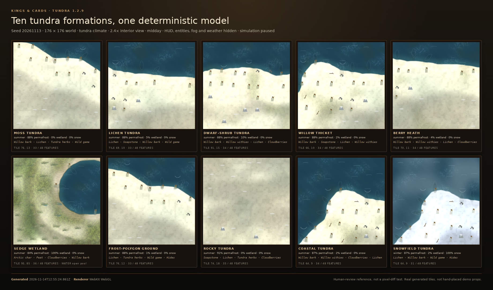
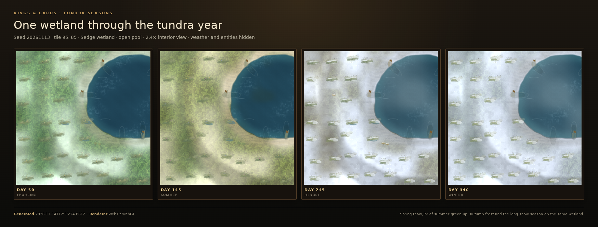

# Tundra 1.2.9

Tundra is not a cold meadow with the trees removed. `game/js/world/tundra-ecology.js`
derives one deterministic profile from height, moisture, temperature, climate,
season, weather, wind and real land use. The same profile feeds terrain colour
and detail, gathering, farm/stable surveys and the shared good ledger. There is
no extra tick loop, no per-tile save data and no parallel inventory.

## Implementation

- **Ecology:** `tundra-ecology.js` with `tundraPotentialAt()`, `isTundraSite()`,
  `tundraProfileAt()`, `tundraGoodsFor()`, `tundraProductsAt()`,
  `tundraSummary()` and `tundraRequirement()`.
- **Climate:** dedicated `tundra` climate (terrain palette, temperature and a
  long snow season). Northern and temperate worlds keep their existing taiga
  and meadow behaviour, so old saves render unchanged.
- **Soil:** permafrost, summer active layer, thaw depth in centimetres,
  hummocks, stone-rimmed frost polygons, cracks, variable bearing strength and
  erosion risk. These are real profile values, not a snow tint.
- **Water:** small wetlands and fens, shallow pools, seasonal spring/summer
  water, winter ice and a water table derived from moisture and relief.
- **Vegetation:** lichens, mosses, sedges, cotton grass, low fescues, dwarf
  willow/birch, crowberry, bearberry, dwarf juniper, low herbs and short-lived
  arctic flowers. Small trees stay below 3 m; no tall forest is generated.
- **Fauna:** moose, reindeer herds, musk ox, arctic fox, wolf, wolverine,
  ptarmigan, snowy owl, migratory goose, arctic hare, lemming, tundra vole and
  summer mosquito swarms.
- **Goods:** cloudberry, crowberry, arctic char, antler, bone, peat, soapstone,
  bog iron, tundra herbs, willow bark and qiviut. Existing lichen, bark, game,
  hides, fur and willow withies stay in the same catalogue.
- **Terrain:** `terrain.js` gives tundra priority over desert/steppe/grassland
  and suppresses forest potential on tundra tiles. `tundra-render.js` draws the
  bounded moss/lichen mat, frost pattern, pool, sedges, shrubs, flowers, snow,
  tracks and a few wildlife silhouettes.
- **Timber:** no tall forest is generated. `resource-geography.js` seeds rare
  low subalpine-scrub stands (4–36 units, roughly 3% of eligible ground) so a
  tundra lumber yard has a small, renewable source of logs and firewood. They
  use the shared forest stock and hauling systems but never render as tall
  woodland; the tundra layer draws only small willow and birch forms.
- **Gathering:** `gatherMeadowProducts()` and
  `gatherNearestGrasslandProducts()` check tundra before desert and steppe.
  Cloudberry, crowberry and arctic char deliver food; tundra herbs and willow
  bark deliver medicine; the remaining goods sell for gold through the existing
  ledger.
- **Economy:** tundra has a short growing season, low building-material yield,
  high fuel and clothing demand, expensive remote supply, reduced winter
  mobility and a strong autumn hunt. `getHarvestYieldFactor()` and
  `calculateFoodSpoilage()` read the climate, while
  `getForestMovementFactorAt()` prices deep snow and the spring thaw.
- **Settlements:** `grasslandSiteSummaryAt()` returns the tundra survey for the
  existing farm/stable panel. No new button or resource model is needed.

## 48-point audit

| ID | Implementation |
| --- | --- |
| 1.2.9.1 | Moose in shrub/wetland tiles plus reindeer lichen and other lichen mats |
| 1.2.9.2 | Short sedges, cotton grass, fescue and alpine bluegrass |
| 1.2.9.3 | Dwarf willow, dwarf birch, crowberry, bearberry and dwarf juniper |
| 1.2.9.4 | `TUNDRA_TREES`: arctic willow, dwarf birch and netleaf willow, all below 3 m |
| 1.2.9.5 | Berry shrubs and seasonal cloudberry/crowberry harvest |
| 1.2.9.6 | Labrador tea, arctic thyme, lousewort and moss campion |
| 1.2.9.7 | Arctic poppy, snow buttercup, fireweed and arctic bluebell |
| 1.2.9.8 | Forest generation is suppressed and `noTallTrees` is always true |
| 1.2.9.9 | `soil.permafrost`, frozen subsoil |
| 1.2.9.10 | `soil.activeLayer` and `soil.thawDepthCm` in summer |
| 1.2.9.11 | `water.wetland`, sedge fen formations |
| 1.2.9.12 | `water.shallowPool`, rendered pool and ice |
| 1.2.9.13 | `landform.frostPolygon` and `polygonCount` |
| 1.2.9.14 | `landform.hill`, `depression`, `hummock` |
| 1.2.9.15 | `landform.frostCrack`, rendered polygon/crack lines |
| 1.2.9.16 | `landform.stability`, `soil.bearing`, `soil.erosion` |
| 1.2.9.17 | Long snow season and high winter `cold` |
| 1.2.9.18 | Short summer warmth curve in `season.js` |
| 1.2.9.19 | `economy.growingSeasonDays` below 120 |
| 1.2.9.20 | Compressed green-up and `vegetation.bloom` |
| 1.2.9.21 | Active layer and `hazards.thaw` |
| 1.2.9.22 | `water.seasonalPool` in spring/summer |
| 1.2.9.23 | `visual.snowCover` and tundra snow outside summer |
| 1.2.9.24 | `visual.colourShift`, seasonal grass/moss/leaf colours |
| 1.2.9.25 | Reindeer, moose and musk ox |
| 1.2.9.26 | Arctic fox |
| 1.2.9.27 | Ptarmigan and snowy owl |
| 1.2.9.28 | Lemming and tundra vole |
| 1.2.9.29 | Wolf and wolverine |
| 1.2.9.30 | Migratory goose in spring, summer and autumn |
| 1.2.9.31 | Mosquito swarms in the short summer |
| 1.2.9.32 | Reindeer herds with migratory behaviour |
| 1.2.9.33 | Lichen, cloudberry and crowberry harvest |
| 1.2.9.34 | Fur and hides from the shared hunt catalogue |
| 1.2.9.35 | Wild game and qiviut |
| 1.2.9.36 | Antler and bone/horn |
| 1.2.9.37 | Arctic char from open pools and wetland water |
| 1.2.9.38 | `soil.peat` and the peat good in fens |
| 1.2.9.39 | Soapstone, bog iron and stone values |
| 1.2.9.40 | Reindeer herding and qiviut; real grazing use raises the value |
| 1.2.9.41 | Short growing season and low agriculture score |
| 1.2.9.42 | Low `economy.buildingMaterials`, sparse scrub stands and no closed canopy |
| 1.2.9.43 | Low bearing strength, permafrost and difficult-soil markers |
| 1.2.9.44 | Cold, hypothermia, frostbite and blizzard hazards |
| 1.2.9.45 | `economy.winterMobility` and snow/thaw movement factor |
| 1.2.9.46 | `economy.remoteSupply` and `supplyCost` |
| 1.2.9.47 | Autumn hunting season and spring/autumn migration economy |
| 1.2.9.48 | Housing insulation, clothing need and fuel demand |

## Tests

- `tests/world/tundra-ecology.test.js`: all 48 requirements, ten formations,
  deterministic survey, seasonality, fauna, goods and delivery channels.
- `tests/presentation/tundra-render.test.js`: all formations render with finite
  coordinates and a bounded call count; small trees and null inputs are safe.
- `npm run test:tundra-reference`: deterministic browser reference with ten
  formations and the same wetland through four seasons.

Reference metadata: `docs/terrain-reference/tundra-reference.json` (seed
20261113, 176 × 176 world, WebGL, formation tiles and SHA-256 hashes).
